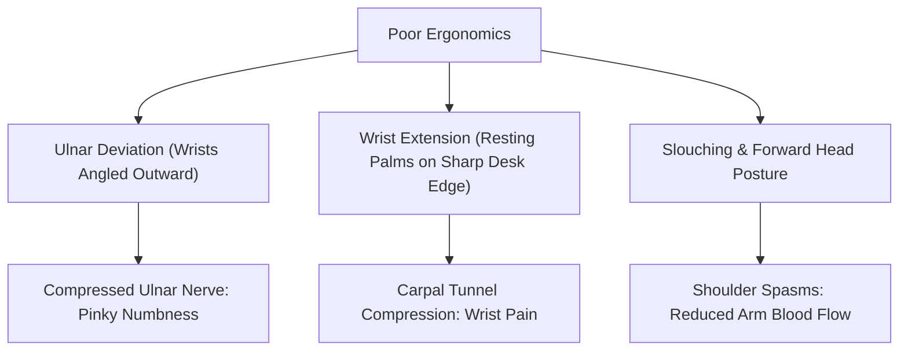

When preparing for competitive typing tests (such as **SSC CGL DEST, CHSL, Allahabad High Court, or Delhi Police HCM**), candidates frequently practice for 2 to 4 hours daily.

Without proper biomechanical posture, this intense repetitive stress quickly leads to **wrist soreness, forearm tightness, finger numbness, and even early Carpal Tunnel Syndrome (CTS)**. Physical fatigue degrades your nervous system's reaction time, reducing your typing speed by **10 to 15 WPM** in the final minutes of an examination.

Here is the **complete ergonomic posture guide** to preserve your joints, eliminate pain, and maximize typing endurance.

---

## ⚡ Ergonomic Desk & Posture Matrix

| Posture Parameter | Correct Ergonomic Alignment | Harmful Habit to Avoid |
| :--- | :--- | :--- |
| **Wrist Angle** | **Neutral / Straight** (In line with forearms) | Wrists bent backward (Wrist Extension) |
| **Elbow Position** | **90° to 100° Angle** (Arms close to torso) | Elbows flared outward or reaching forward |
| **Chair Height** | Feet flat on the floor; thighs parallel to ground | Dangling legs or sitting on feet |
| **Monitor Eye Level** | **Top third of screen at eye level** (Arm's length)| Tilting neck downward to look at screen |
| **Keystroke Force** | **Light, fluid taps** (Actuate just enough) | Hammering and bottoming out violently |
| **Finger Curve** | **Curved claw / relaxed arch** | Flat, straight fingers |

---

## 1. The 3 Deadly Posture Sins That Destroy Typing Speed

### ❌ Sin 1: Ulnar Deviation (Twisting Hands Outward)
Many typists rest their palms close together and splay their hands outward toward the outer edges of the keyboard. This bends the wrist horizontally, compressing the ulnar nerve and causing tingling in the ring and pinky fingers.
* **Correction**: Keep your forearms, wrists, and hands in one continuous straight line pointing toward the keyboard center.

### ❌ Sin 2: Desk-Edge Compression (Wrist Extension)
Resting the base of your palms or wrists directly against the sharp corner of your computer table compresses the median nerve inside the carpal tunnel.
* **Correction**: Elevate your wrists slightly while typing, or use a wide, padded memory-foam palm rest positioned 2 inches below the spacebar.

### ❌ Sin 3: Key Pounding (Excessive Actuation Force)
Many candidates smash keys with 3 to 4 times more force than necessary, especially when feeling exam pressure. This sends shockwaves into finger joints and inflames tendons.
* **Correction**: Practice gentle, rhythmic keystrokes. Touch typing requires only enough pressure to trip the key switch or collapse the membrane dome.

---

## 2. The 3-Minute Pre-Exam Hand & Wrist Warm-up Routine

Perform these 3 therapeutic stretches before starting your daily typing session or entering the exam hall:

1. **The Prayer Stretch (Forearm Flexor Release)**:
   - Place your palms together in front of your chest in a prayer position.
   - Slowly lower your hands toward your waist while keeping palms pressed together until you feel a gentle stretch along your inner forearms.
   - Hold for 15 seconds; repeat 3 times.
2. **Finger Splay & Fist Clench (Tendon Gliding)**:
   - Make a tight fist with both hands for 3 seconds.
   - Splay your fingers open as wide as possible for 3 seconds.
   - Repeat 10 times to boost peripheral blood circulation and warm up cold fingers.
3. **Wrist Rotations**:
   - Gently rotate both wrists in circular motions (10 clockwise, 10 counter-clockwise) to lubricate synovial joints.

---

## 3. Combating Cold Hands & Exam Room Shivering

Government test centers (TCS iON labs) are often aggressively air-conditioned. Cold hands reduce finger dexterity and neuromuscular firing rates by up to 30%.

* **Wash with Warm Water**: Before your exam reporting time, run your hands under warm tap water in the restroom for 60 seconds.
* **Hand Rubbing**: Rub your palms together vigorously to generate friction heat right before sitting at your terminal.
* Read our dedicated psychological and physiological guide on [How to Stop Hand Shivering During Typing Tests](/blog/how-to-stop-hand-shivering-during-typing-test/).

---

## 4. Related Speed & Technique Guides

- **Finger Anchoring**: Learn exact finger mapping in [Touch Typing Home Row Rules & Finger Placement Chart](/blog/touch-typing-home-row-rules-finger-placement-chart/).
- **Keyboard Hardware**: Discover wrist-friendly switches in [Mechanical Keyboard Switch Guide (Red vs Brown vs Blue)](/blog/mechanical-keyboard-switch-guide/).
- **Speed Drills**: Boost your output with [10 Proven Tips to Increase Typing Speed (30 to 70+ WPM)](/blog/10-tips-to-increase-typing-speed/).
- **Practice Routine**: Follow our structured [30-Day Typing Speed Improvement Plan](/blog/typing-speed-from-30-to-50-wpm-in-30-days-plan/).

---

## 5. Practice Safely on TypingWire

Maintain healthy posture and track your net speed and error penalties across realistic exam simulations on **[TypingWire.in](https://typingwire.in)**.
