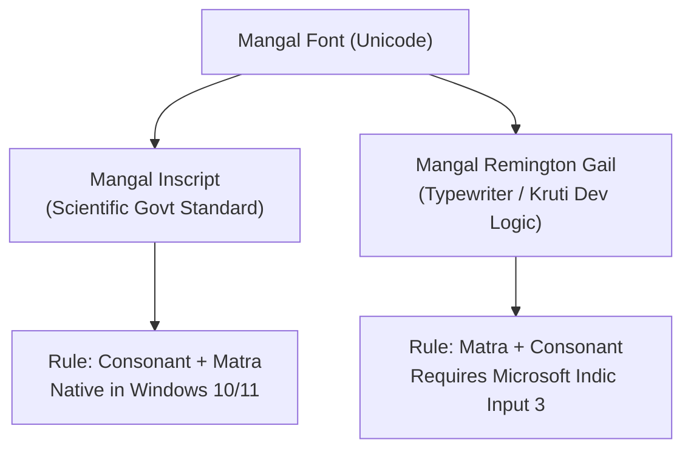

Preparing for a **government Hindi typing examination** (SSC CGL DEST, CHSL, High Court Clerk, UP Police ASI, or RRB NTPC) can be confusing because different commissions mandate different fonts and keyboard layouts.

Practicing for months on the wrong layout can lead to disastrous disqualification on exam day. In this comprehensive reference, we analyze the structural mechanics, **Unicode vs Non-Unicode differences**, matra placement rules, and state-by-state exam guidelines.

---

## ⚡ Hindi Keyboard Layout Matrix (At a Glance)

| Feature | Mangal Inscript | Mangal Remington Gail | Kruti Dev 010 / DevLys 010 |
| :--- | :--- | :--- | :--- |
| **Font Type** | **Unicode Standard** | **Unicode Standard** | Non-Unicode (Legacy 8-bit ASCII) |
| **Governing Standard** | BIS (Govt of India Official) | Mechanical Typewriter Layout | Commercial Font Remapping |
| **Key Arrangement** | Phonetic (Vowels Left, Consonants Right) | Typewriter Muscle Memory | Typewriter QWERTY Remap |
| **Best Suited For** | **Absolute Beginners & Freshers** | **Candidates with Kruti Dev Background**| Candidates targeting Rajasthan/State exams |
| **Short 'i' Matra (ि)** | Type **Consonant First**, then Matra | Type **Matra First**, then Consonant | Type **Matra First**, then Consonant |
| **Half-Letter (Halant)**| Type Consonant + `D` (Halant) | Shift Key or specific Alt codes | Shift Key or legacy Alt codes |
| **OS Requirement** | **Native in Windows 10/11** (Zero installs) | Requires Microsoft Indic Input 3 | Requires TTF Font file installation |
| **Accepted In** | **SSC, RRB, Courts, Police, All Central**| **SSC, Courts, UP Police** | **Rajasthan HC, RSMSSB, UPSSSC (Optional)**|

---

## 1. Unicode Mangal vs Legacy Kruti Dev: The Core Difference

### 🔹 What is Unicode (Mangal)?
Unicode is an international character encoding standard. In Mangal:
- The character `क` is stored digitally as the unique Unicode hex value `U+0915`.
- Text typed in Mangal can be copied, pasted, searched on Google, or emailed across any smartphone, Mac, or Windows terminal without turning into garbled gibberish.
- **Central commissions (SSC, Railway RRB, Delhi DSSSB, NTA) strictly mandate Unicode fonts.**

### 🔹 What is Non-Unicode (Kruti Dev / DevLys)?
Kruti Dev is an ASCII font created in the 1990s:
- It replaces English alphabet glyphs with Hindi characters (for example, typing English `d` displays `क`).
- If you copy Kruti Dev text into a search bar or modern web browser that doesn't have the `.ttf` font installed, it appears as random English letters (`d k j l`).
- **Legacy state boards (especially in Rajasthan and Haryana)** continue using Kruti Dev due to older court stenography traditions.

---

## 2. Inscript vs Remington Gail: Critical Technical Differences

Even when an exam uses Mangal font, the candidate must select between **Inscript** and **Remington Gail**:

### 🅰️ The "Chhoti 'i' Ki Matra" (ि) Trap
This is the single biggest cause of confusion:
* **In Remington Gail**: If you want to type **कि**:
  1. You must first press the matra key (`f`).
  2. Then you press the consonant key (`d` for `क`).
  3. The character renders as **कि**.
* **In Mangal Inscript**: You type naturally in phonetic reading order:
  1. You first press the consonant key (`k` for `क`).
  2. Then you press the matra key (`f` for `ि`).
  3. The Unicode rendering engine automatically places the matra to the left: **कि**.

### 🅱️ Conjuncts & Half Letters (Aadhe Akshar)
* **Inscript Rule**: To make any consonant half, simply press the consonant followed by the **Halant key (`d` in Inscript)**:
  - `क` + `्` + `य` = **क्य**
  - `प` + `्` + `र` = **प्र**
  - `त` + `्` + `र` = **त्र**
  - `ज` + `्` + `ञ` = **ज्ञ**
* **Remington Gail Rule**: Many half-characters require using the `Shift` key with specific characters, or memorizing Alt code sequences for rare conjuncts (`द्ध`, `द्घ`, `ट्ट`).

---

## 3. Step-by-Step Installation Guide on Windows 10 & 11

### 💻 How to Enable Mangal Inscript (No Software Needed)
1. Open **Settings** $\rightarrow$ **Time & Language** $\rightarrow$ **Language & Region**.
2. Click **Add a language** $\rightarrow$ Search for **Hindi (हिन्दी)** and install it.
3. Click on the three dots next to Hindi $\rightarrow$ **Language options**.
4. Under the Keyboards section, ensure **Hindi Inscript** is present.
5. To switch while typing, simply press **Windows Key + Spacebar** or **Left Alt + Shift**.

### 💻 How to Install Remington Gail (Indic Input 3)
1. Download **Microsoft Indic Input 3 (Hindi 64-bit)** from the official Microsoft Language Portal or Bhashaindia archive.
2. Run the `.msi` setup installer.
3. Once installed, switch keyboard language to **Hindi (Indic Input 3)** using `Windows Key + Spacebar`.
4. Click on the floating keyboard toolbar $\rightarrow$ Select **Remington (Gail)** layout.

---

## 4. State & Central Exam Authority Breakdown

Before beginning your preparation, consult this official exam compatibility list:

* **Staff Selection Commission (SSC CGL / CHSL / Steno / Selection Post)**:
  - Font: **Mangal (Unicode)**.
  - Layout Options: Inscript, Remington Gail, and CBI layout selectable at login.
* **Railway Recruitment Boards (RRB NTPC CBTST)**:
  - Font: **Mangal (Unicode)**.
  - Layout Options: Inscript and Remington Gail.
* **Allahabad High Court (RO / ARO / Group-C Clerk)**:
  - Font: **Mangal (Unicode)** for English & Hindi bilingual posts.
* **Rajasthan High Court & RSMSSB (LDC / Information Assistant)**:
  - Font: **Kruti Dev 010 / DevLys 010**.
  - Layout: Traditional Remington layout.
* **UP Police (ASI Accounts, Clerk, Computer Operator)**:
  - Font: **Mangal (Unicode)** (Inscript mandatory or selectable).
* **Bihar Civil Court & Vidhan Sabha**:
  - Font: **Mangal (Remington Gail / Inscript)**.

---

## 5. Related Hindi Typing & Speed Guides

Continue mastering Hindi typing accuracy and speed metrics with our companion guides:
- **Alt Codes Reference**: Memorize tough characters in [Kruti Dev & Mangal Hindi Typing Alt Codes List & Chart](/blog/krutidev-mangal-hindi-typing-alt-codes-list-chart/).
- **Speed Drills**: Learn high-speed techniques in [How to Increase Hindi Typing Speed in Mangal & Kruti Dev](/blog/how-to-increase-hindi-typing-speed-mangal-krutidev/).
- **Exam Passages**: Practice with [Hindi Typing Test Practice Passages (Mangal & Kruti Dev)](/blog/hindi-typing-test-practice-passages-mangal-krutidev/).
- **Mobile OTG Setup**: Practice on smartphones with [Mobile me OTG Keyboard Lagakar Hindi Typing Kaise Kare](/blog/mobile-me-otg-keyboard-lagakar-typing-practice-kaise-kare/).

---

## 6. Daily Practice Protocol

1. **Pick One Layout and Stick to It**: Switching back and forth between Inscript and Remington Gail damages muscle memory. Once chosen, practice exclusively on that layout for 60 to 90 days.
2. **Master the Home Row First**: In Inscript, the home row anchors are `अ इ उ ए` (left hand) and `प र क त` (right hand).
3. **Practice on Real Exam Software**: Take 10-minute and 15-minute simulated exam sessions on **[TypingWire.in](https://typingwire.in)** with full support for Mangal Inscript, Remington Gail, and Kruti Dev 010.
