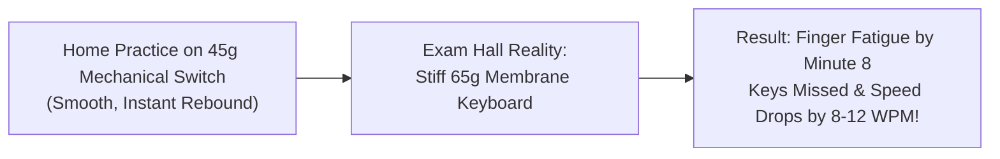

When training for government typing examinations (SSC CGL DEST, CHSL, Railway RRB NTPC, or High Court Clerkships) or working long daily coding sessions, your keyboard hardware directly influences your **keystroke accuracy, speed generation, and finger fatigue**.

However, there is a dangerous trap: **many candidates train exclusively on expensive mechanical keyboards at home, only to fail in the exam hall** because the government test center provides a stiff, low-cost membrane keyboard.

In this hardware review, we analyze switch mechanics, actuation profiles, and the exact strategy needed to master both mechanical precision and exam-day membrane reality.

---

## ⚡ Switch Technical Specifications Matrix

| Switch Type | Mechanical Action | Actuation Force | Actuation Distance | Bottom-Out Travel | Acoustic Profile | Best Use Case |
| :--- | :--- | :--- | :--- | :--- | :--- | :--- |
| **Cherry MX / Gateron Red** | Linear (Smooth) | **45 cN (Light)** | 2.0 mm | 4.0 mm | Quiet (Thock) | High-speed burst typing & Gaming |
| **Cherry MX / Outemu Brown** | Tactile (Subtle Bump) | **55 cN (Medium)** | 2.0 mm | 4.0 mm | Medium Quiet | **Daily Typing & Exam Accuracy Drills** |
| **Cherry MX / Longhua Blue** | Clicky (Audible Click) | **60 cN (Heavy)** | 2.2 mm | 4.0 mm | Very Loud (Click) | Tactile sensory feedback & Steno practice |
| **Gateron Yellow (Linear)** | Linear (Buttery Smooth)| **50 cN (Medium)** | 2.0 mm | 4.0 mm | Quiet Deep | Smooth sustained typing sessions |
| **Speed Silver (Linear)** | Linear (Short Travel) | **45 cN (Fast)** | **1.2 mm** | 3.4 mm | Quiet | Rapid twitch inputs (High error rate for beginners) |
| **Standard Exam Membrane** | Rubber Dome | **55g - 65g (Stiff)** | 2.5 mm - 3.0 mm | 3.8 mm | Muffled Mushy | **Official SSC, NTA & RRB Exam Centers** |

---

## 1. The Three Mechanical Switch Families Explained

Mechanical switches operate via physical spring-loaded mechanisms rather than rubber domes:

### 🟤 Tactile Switches (Brown Switches — The Gold Standard for Typing)
* **How they work**: As you press the key halfway down, you feel a distinct tactile "bump" indicating the keystroke has been registered by the computer.
* **Why typists love them**: You do not have to bottom out the key completely (press all the way to the plastic floor) to trigger the letter. This saves finger energy and prevents Repetitive Strain Injury (RSI).
* **Top choices**: Gateron Brown, Akko CS Lavender, Outemu Brown, Cherry MX Brown.

### 🔴 Linear Switches (Red & Yellow Switches — Effortless Glide)
* **How they work**: The stem moves downward in one completely smooth, uninterrupted motion with zero tactile resistance or bump.
* **Pros**: Extremely low actuation force (45g) enables rapid finger fluttering and high bursts exceeding 90+ WPM.
* **Cons**: Because there is no bump, beginners often accidentally trigger adjacent keys by merely resting their fingers on the keycaps.

### 🔵 Clicky Switches (Blue Switches — Retro Typewriter Nostalgia)
* **How they work**: The switch stem features a two-piece slider that produces a loud, crisp metallic "click" at the exact actuation point.
* **Pros**: Incredible sensory feedback; you never doubt whether a key registered. Used famously in the iconic Indian court keyboard, the **TVS Gold**.
* **Cons**: Unbearably loud for shared apartments, call centers, or libraries. Prolonged 15-minute sessions can cause finger fatigue due to the heavy 60g spring.

---

## 2. The "Exam Hall Shock" Warning (Mechanical vs Membrane)

The biggest mistake aspirants make is assuming the exam hall keyboard will feel like their custom mechanical board:

* **Why Exam Centers Use Membrane Keyboards**: Recruitment agencies (TCS iON and NTA) use commercial membrane keyboards like the **Dell KB216, HP 100, or ProDot** because they are cheap, durable, and spill-resistant.
* **The Muscle Memory Trap**: Membrane keyboards require **bottoming out** (pressing the key all the way down until the rubber dome collapses against the circuit sheet). If your fingers are accustomed to the feather-light 45g actuation of mechanical switches, your fingers will fail to press membrane keys deep enough, causing skipped letters.

---

## 3. Recommended Two-Tier Training Strategy

To guarantee top scores on exam day, implement this two-tier hardware routine:

1. **Foundation Phase (Weeks 1 to 4)**:
   - Practice on a **Tactile Brown Switch mechanical keyboard** (or TVS Gold).
   - Focus on mastering home-row finger independence, rhythm, and blind touch-typing.
2. **Exam Hardening Phase (2 Weeks Before Exam)**:
   - Pack away your mechanical board and connect a standard budget **USB membrane keyboard (e.g. Dell KB216 or Logitech K120)**.
   - Practice daily 10-minute and 15-minute simulated exam sessions on **[TypingWire.in](https://typingwire.in)** to build finger stamina for stiff membrane domes.

---

## 4. Related Hardware & Technique Guides

- **Court Standard Keyboard**: Read our comprehensive [TVS Gold Mechanical Keyboard Review & Exam Guide](/blog/tvs-gold-keyboard-typing-test-review-guide/).
- **Speed Drills**: Learn high-speed techniques in [10 Proven Tips to Increase Typing Speed](/blog/10-tips-to-increase-typing-speed/).
- **Ergonomics**: Master posture in [Touch Typing Home Row Rules & Finger Placement Chart](/blog/touch-typing-home-row-rules-finger-placement-chart/).
- **Mobile OTG Setup**: Practice on smartphones with [Mobile me OTG Keyboard Lagakar Typing Practice Kaise Kare](/blog/mobile-me-otg-keyboard-lagakar-typing-practice-kaise-kare/).
