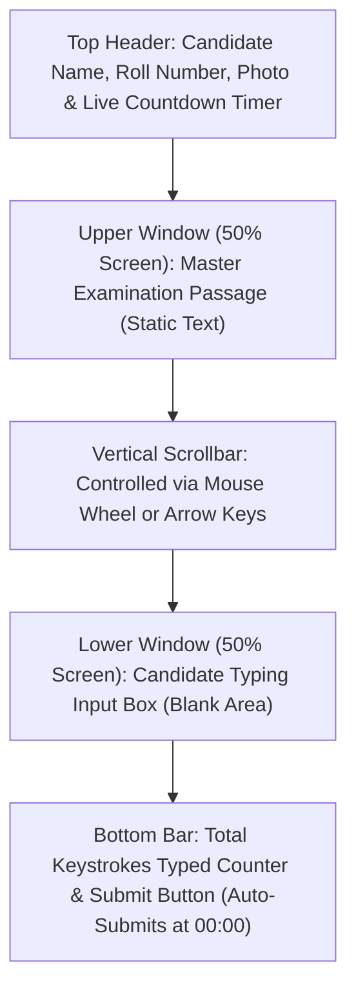

Most major government recruitment typing examinations in India — including **SSC CGL DEST, SSC CHSL, SSC Stenographer, Railway RRB NTPC, and Central Selection Posts** — are conducted by **Tata Consultancy Services (TCS)** on their proprietary **TCS iON Digital Assessment Platform**.

A significant percentage of well-prepared candidates fail on exam day simply because the **TCS iON interface behaves very differently from casual online typing games**. Practicing on software that spoon-feeds green/red highlights and auto-scrolls creates false confidence that shatters inside the examination hall.

This comprehensive guide details the **exact physical and graphical architecture of the TCS iON exam terminal**, key restrictions, and how to practice effectively.

---

## ⚡ TCS iON Interface Snapshot (Fact Matrix)

| Interface Parameter | TCS iON Official Exam Specification | Impact on Candidates |
| :--- | :--- | :--- |
| **Screen Layout** | **Split-Screen Horizontal** (Master on Top, Input at Bottom) | Must look up and down continuously |
| **Word Highlighting** | **Completely Disabled** (No green/yellow/red indicators) | Must track cursor position blind |
| **Auto-Scrolling** | **Disabled** (Manual mouse wheel or down-arrow required) | Risk of losing reading place |
| **Backspace Usage** | **Allowed** (Unlimited in SSC; Restricted in Railway CBTST) | Burns valuable seconds if overused |
| **Keyboard Shortcuts** | **100% Blocked** (`Ctrl+C`, `Ctrl+V`, `Ctrl+A`, `Alt+Tab`) | Cannot mass-delete or copy text |
| **Pre-Exam Trial** | **Mandatory 5-Minute Mock Session** | Critical window to replace faulty keyboards |
| **Rest Interval** | **3 to 5 Minutes Break** between Demo and Main Test | Relaxes finger tension and calms nerves |

---

## 1. Visual Layout of the TCS iON Testing Screen

When you log in at your assigned TCS iON digital zone terminal, the screen is structured into distinct functional zones:

1. **Header Bar**: Displays your roll number, candidate photograph, subject code, and a persistent live digital timer counting down remaining minutes and seconds.
2. **Master Passage Box (Top Half)**: Displays the official evaluation text (approx. 350 to 400 words for SSC). The font size is standard 12pt to 14pt sans-serif.
3. **Candidate Input Box (Bottom Half)**: A blank editable text box where your typed letters appear.
4. **Footer Counter**: Displays a live count of total keystrokes or words entered. The **Submit** button is disabled until the timer reaches zero, at which point the exam automatically submits.

---

## 2. The 3 Biggest Traps of the TCS iON Interface

### ❌ Trap 1: The "No Highlighting" Panic
Online typing games highlight the current word in bright yellow and change mistyped characters to red. 
* On TCS iON, **the master passage is plain black text on white background**.
* If you lose your visual place in the text, you will experience a 5 to 10-second freeze trying to locate which line you were typing.
* **Solution**: Train your eyes to read 2 to 3 words ahead of what your fingers are striking, and never practice with software highlights enabled.

### ❌ Trap 2: The Manual Scroll Hurdle
The master passage window displays approximately 5 to 7 lines of text at a time. 
* As you type toward line 6, **the text does NOT automatically glide downward**.
* Candidates who do not realize this suddenly find themselves staring at the bottom border with no more text visible.
* **Solution**: Keep your left hand on the home row and use your right hand to smoothly roll the mouse wheel downward every 3 lines.

### ❌ Trap 3: The Sticky Spacebar at Exam Centers
TCS iON centers use external membrane keyboards (Dell KB216, HP, or ProDot) that have been hammered by thousands of previous examinees.
* A sticky Spacebar may fail to register, resulting in merged words (`inorder` instead of `in order`), which counts as a Full Mistake.
* A loose Spacebar may register twice, creating double-spacing penalties (Half Mistakes).

---

## 3. The 5-Minute Mock Trial Protocol (What to Do)

Before your main 10 or 15-minute exam begins, the TCS iON system initiates a **5-minute Demo Mock Test**.

Do **not** sit idle during this trial! Execute this 4-step hardware stress test:
1. **Test the Spacebar**: Type 20 single words with spaces. Confirm that every space registers cleanly without jamming or double-spacing.
2. **Test Both Shift Keys**: Type alternating capital letters (`Aa Bb Cc Dd`) using the Left Shift for right-hand letters and Right Shift for left-hand letters.
3. **Test the Backspace & Enter Keys**: Ensure the Backspace key rebounds immediately without sticking downward.
4. **Inspect the Physical Cable**: Ensure the USB cable connecting to the CPU is secure and does not disconnect when you adjust keyboard positioning on the desk.

> [!IMPORTANT]
> If any key feels stiff, mushy, or unresponsive during the 5-minute mock, **raise your hand immediately**. The TCS iON invigilators have spare keyboards in the room and will hot-swap your keyboard before the real exam timer starts. Once the main timer starts, no replacements are permitted!

---

## 4. Related Exam Rules & Speed Guides

Deepen your exam readiness across official evaluation formulas and software rules:
- **SSC CGL DEST Rules**: Read [SSC CGL Typing Test Rules: Speed (27 WPM) & Mistakes Allowed](/blog/ssc-cgl-dest-typing-test-rules/).
- **SSC CHSL LDC & DEO**: Review [SSC CHSL Typing Test Rules: 35 vs 50 WPM Guidelines](/blog/ssc-chsl-typing-test-rules/).
- **Official Mistake Annexure**: Check the [Official SSC Typing Evaluation Guidelines (Full vs Half Mistakes)](/blog/official-ssc-typing-evaluation-guidelines-full-half-mistake-annexure/).
- **Railway CBTST Rules**: See [RRB NTPC CBTST Typing Test Rules & 5% Mistake Formula](/blog/rrb-ntpc-cbtst-typing-skill-test-rules/).
- **Speed Math**: Understand keystroke math in [KDPH to WPM Speed Calculation Formula Guide](/blog/kdph-to-wpm-speed-calculation-formula-guide/).

---

## 5. Practice Exact TCS iON Interface on TypingWire

Do not let software surprises disqualify you after months of study. Practice on **[TypingWire.in](https://typingwire.in)** with our dedicated **TCS iON Simulation Mode** featuring:
- Identical split-screen horizontal geometry.
- Disabled word highlighting and live error coloring.
- Manual passage scrollbar mechanics.
- Instant official SSC & Railway error percentage calculation.
